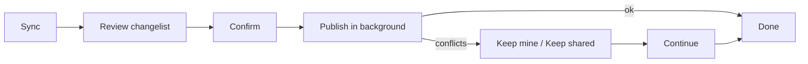

# Gitoza

**Gitoza** is a local-first desktop app for **test management** and **task tracking as files in Git** (Task-as-Code + Test-as-Code). Tickets, wiki pages, test cases, and test runs live as YAML in your repository; the app runs on your machine—there is no central cloud database for that data.


Built for QA and engineering teams who want planning and verification in the same Git workflow, with tickets linked to cases and runs. Teammates share work on branch `gitoza`: hit **Sync**, review changes like an IDE diff, then confirm. Git fetch, rebase, and push run in the background—no Git knowledge required. Overlapping edits pause for **Keep mine** / **Keep shared version**.

## Download

- **Installers (recommended):** [gitoza.com](https://gitoza.com) — Windows, macOS, and Linux builds served from the official CDN.
- **Source:** this repository (see [Build from source](#build-from-source) below). GitHub Releases may mirror the same artifacts when published.


## Generate tickets and cases with AI

Copy the workspace path from Gitoza, open the repo in an AI coding agent, and generate tickets and test cases from your code.


[Watch on YouTube](https://www.youtube.com/watch?v=UZwE5e0RM-A)

## Getting started

1. Install from [gitoza.com](https://gitoza.com) and open the app.
2. Connect a Git remote (your team’s repository).
3. Create or edit tickets, wiki pages, test cases, and test runs in the UI.
4. Hit **Sync**, review the changelist like an IDE diff, then confirm.
5. If someone else changed the same items, choose **Keep mine** or **Keep shared version**, then continue.

Everything you edit is stored as files in your repository. Sync publishes those changes for your teammates.

## What you can do

- **Tickets / Releases** — Track work, link tickets to test cases and runs, manage releases per project
- **Library (Wiki)** — Team documentation in nested folders
- **Test Repository** — Browse and edit cases (one file per case), auto-save, review/approve workflow
- **Test Run** — Run cases manually and record results
- **Test Automation** — Optional CI JUnit results via Storage Sync
- **Team sync** — Share work with colleagues via **Sync** → review → confirm (Git runs in the background)
- **Conflict review** — On overlapping edits, choose **Keep mine** or **Keep shared version**—no manual merge required
- **Dashboard & search** — Project overview and filters
- **Import / export** — CSV import and case/run export from the app


## Team sync

You do not need to use Git yourself. Hit **Sync**, review the changelist like an IDE diff, then confirm. The app publishes to branch `gitoza` in the background.

If someone else changed the same items, sync pauses for review. For each overlap, choose **Keep mine** or **Keep shared version**; other conflict types (delete/move, rename) have matching choices in the app. **Continue** finishes publish; **Cancel** discards the in-progress sync.

If sync is interrupted (crash or restart), the app rolls back so your workspace is not left half-finished.




## Where your data lives

- **On your machine:** settings and a local index under `~/.gitoza`
- **In your Git repo** (branch `gitoza`): shared files under `.gitoza/`


| In the repo                                     | What                        |
| ----------------------------------------------- | --------------------------- |
| `.gitoza/tasks/tickets/<project>/…`             | Tickets and releases        |
| `.gitoza/wiki/…`                                | Wiki pages (nested folders) |
| `.gitoza/test/cases/<project>/…/<case_id>.yaml` | Test cases                  |
| `.gitoza/test/runs/<run_id>/`                   | Test runs                   |
| `.gitoza/test/templates/*.md`                   | Case templates              |
| `.gitoza/config.json`                           | Team project settings       |


Task and test data stay on the dedicated `gitoza` branch (or a dedicated repo that uses that branch). You do not merge them into your code mainline—so tickets, wiki, and tests never pollute application source.

More detail: `[docs/DATA-LAYOUT.md](docs/DATA-LAYOUT.md)`.

## Feedback

Bug reports and feature requests via [GitHub Issues](https://github.com/gitoza-io/gitoza/issues) are welcome. Please describe the problem or idea clearly. Pull requests are not open yet.

## License

Licensed under the **Apache License, Version 2.0** — see [LICENSE](LICENSE) and [NOTICE](NOTICE).

## Build from source

For developers who want to run the app from this repository:

- **Node.js** 18+
- **Rust** 1.77+ ([rustup](https://rustup.rs/))
- **Tauri system dependencies** — see [Tauri prerequisites](https://v2.tauri.app/start/prerequisites/)
- **Git** (CLI) for repository operations

```bash
npm install
cd frontend && npm install && cd ..
npm run tauri:dev
```

Production build: `npm run tauri:build`.

Internals and architecture: `[docs/README.md](docs/README.md)`.