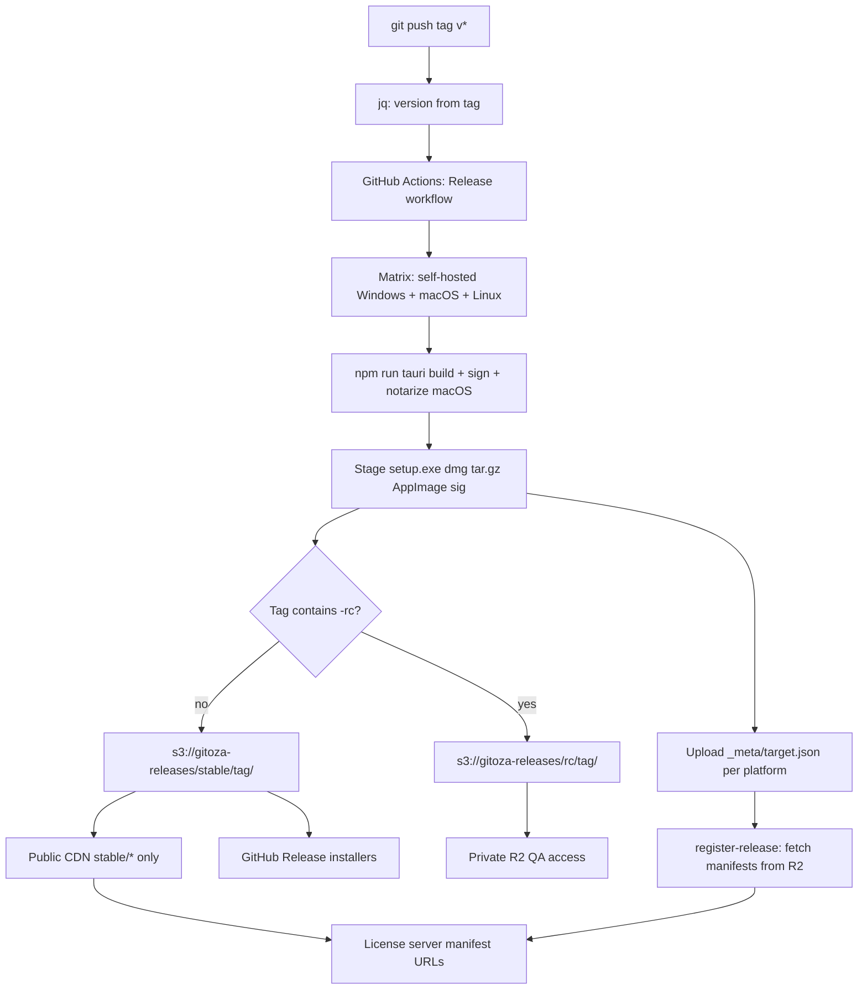

# Desktop release build (GitHub Actions → Cloudflare R2)

This document describes how **Gitoza** desktop installers and updater artifacts are built in CI and published to **Cloudflare R2**. It covers the workflow file, release channels (`stable` vs `rc`), secrets, artifact types, and operator checklists.

For how installed apps **discover and install** updates (license server, updater plugin, eligibility), see [`docs/arch/update/README.md`](../update/README.md).

**Scope:** Tauri desktop release pipeline only. The license server and R2 bucket policy are configured outside this repository.

---

## 1. Overview

| Piece | Location |
|-------|----------|
| Workflow | [`.github/workflows/release.yml`](../../../.github/workflows/release.yml) |
| App version (release builds) | Set in CI from the Git tag (`v1.0.0-rc.2` → `1.0.0-rc.2`) |
| App version (local dev) | Placeholder `0.0.0-dev` in [`src-tauri/tauri.conf.json`](../../../src-tauri/tauri.conf.json) |
| Bundle / updater config | Base: `bundle.targets: ["nsis", "dmg", "app"]` in `tauri.conf.json`; Linux: `["appimage"]` in [`tauri.linux.conf.json`](../../../src-tauri/tauri.linux.conf.json). `createUpdaterArtifacts: true` — `app` is required for macOS `.app.tar.gz` updater artifacts (`dmg` alone is install-only) |
| Windows NSIS branding | [`tauri.windows.conf.json`](../../../src-tauri/tauri.windows.conf.json) — per-user NSIS installer (one-click passive template), installer icon, publisher metadata |
| Updater public key | `plugins.updater.pubkey` in `tauri.conf.json` |
| Updater endpoints (git) | Empty `plugins.updater.endpoints: []` — source builds do not phone home |
| Updater endpoints (release) | Injected by [`.github/scripts/set-app-version-from-tag.mjs`](../../../.github/scripts/set-app-version-from-tag.mjs) (public host + `stable`/`rc` channel; not a GitHub secret) |
| Destination bucket | `gitoza-releases` on Cloudflare R2 |

**Trigger:** Push any Git tag matching `v*` (e.g. `v1.0.0`, `v1.0.0-rc.2`).

**Output:** Signed installers and updater bundles synced to R2 under a channel prefix derived from the tag name.

---

## 2. Pipeline flow



All matrix jobs upload into the **same** R2 prefix for a given tag; Windows, macOS, and Linux artifacts do not overwrite each other.

**GitHub Releases (stable only):** After the matrix succeeds, job `github-release` downloads end-user installers (`.exe` / `.dmg` / `.AppImage` only) from the stable R2 prefix and creates or updates a public [GitHub Release](https://github.com/gitoza-io/gitoza/releases) for that tag. Tags containing `-rc` skip this job. Updater `.sig` / `.app.tar.gz` stay on R2 only. CDN/`gitoza.com` remains the recommended download path; GitHub is a mirror.

---

## 3. Build matrix

| Runner | Tauri `args` | `CARGO_TARGET_DIR` | Bundle directory after build |
|--------|--------------|--------------------|------------------------------|
| `[self-hosted, Windows, X64]` | (default target) | `C:\cargo-target-gittestlens` | `C:\cargo-target-gittestlens\release\bundle` |
| `[self-hosted, macOS, ARM64]` | `--target aarch64-apple-darwin` | `/Users/gitoza/cargo-target-gittestlens` | `…/aarch64-apple-darwin/release/bundle` |
| `[self-hosted, X64, Linux]` | (default target) | `$HOME/cargo-target-gittestlens` | `…/release/bundle` |

**Platforms shipped today:** Windows x64 (NSIS `*-setup.exe`), macOS Apple Silicon (`.dmg` + `.app.tar.gz` updater), Linux x86_64 (`.AppImage` + `.AppImage.sig`). macOS bundle targets include `app` so updater artifacts are produced; `dmg` alone is install-only. Linux uses `tauri.linux.conf.json` (`appimage` only`). No MSI (WiX does not support semver pre-release labels like `rc.2`).

**Version and updater URL from tag:** After checkout, CI runs [`.github/scripts/set-app-version-from-tag.mjs`](../../../.github/scripts/set-app-version-from-tag.mjs) to set `tauri.conf.json` `version` from `github.ref_name` (strip leading `v`) and fill `plugins.updater.endpoints` (empty in git). No manual bump in git before tagging.

**Toolchains on each runner:**

- Node.js LTS with npm cache (`package-lock.json`, `frontend/package-lock.json`)
- Rust stable (`dtolnay/rust-toolchain`); macOS job also installs `aarch64-apple-darwin` target
- Linux self-hosted runner must already have WebKitGTK, GTK3, and AppImage tooling (see [Tauri Linux prerequisites](https://v2.tauri.app/start/prerequisites/))
- Root and `frontend/` `npm install`, then `npm run tauri -- build` with `CARGO_INCREMENTAL=1` (no GitHub Actions Rust cache)
- macOS job: App Store Connect API credentials are materialized before build; Tauri submits to `notarytool`, waits for approval, and staples the ticket. A post-build `spctl` / `stapler validate` step confirms notarization before R2 upload.

**macOS code signing:** `bundle.macOS.signingIdentity` in [`tauri.conf.json`](../../../src-tauri/tauri.conf.json) uses the Developer ID certificate installed on the self-hosted macOS runner keychain. Notarization credentials come from GitHub secrets (see §6).

---

## 4. Release channels (R2 prefixes)

CI sets the upload prefix from the tag name:

| Condition | R2 path | Updater channel (baked in binary) | License server |
|-----------|---------|-----------------------------------|----------------|
| Tag contains `-rc` (e.g. `v1.0.0-rc.2`) | `rc/<tag>/` | `rc` | `GET /updates/rc/...` |
| Otherwise (e.g. `v1.0.0`) | `stable/<tag>/` | `stable` | `GET /updates/stable/...` |

Implementation in the workflow: **Set R2 channel prefix** step, then `aws s3 sync` to  
`s3://gitoza-releases/${prefix}/${{ github.ref_name }}/`.

**Cloudflare operator task:** Restrict public read (custom domain or bucket policy) to `stable/*`. The `rc/` prefix stays private; use presigned URLs or the R2 console for internal QA.

---

## 5. Artifacts uploaded

After build, CI copies release artifacts from the bundle tree into `release-assets/` and syncs them to R2. Staging filters by the **current tag version** (`GITHUB_REF_NAME` → e.g. `1.0.3-rc.2`): only files whose names contain `_<version>_` are copied. Stale installers left in the persistent `CARGO_TARGET_DIR` from earlier releases are skipped. The upload step and manifest builder apply the same version check and fail if mismatched files are present.

| Pattern | Typical use |
|---------|-------------|
| `*-setup.exe` | Windows installer and in-app updater (Tauri 2 reuses the NSIS exe) |
| `*-setup.exe.sig` | minisign signature for Windows updater |
| `*.dmg` | macOS installer |
| `*.app.tar.gz` | macOS updater payload |
| `*.app.tar.gz.sig` | minisign signature for macOS updater |
| `*.AppImage` | Linux installer and in-app updater (Tauri reuses the AppImage) |
| `*.AppImage.sig` | minisign signature for Linux updater |

Requires `bundle.createUpdaterArtifacts: true` in [`tauri.conf.json`](../../../src-tauri/tauri.conf.json). Windows/Linux artifacts include the version in the filename (e.g. `Gitoza_1.0.0-rc.2_x64-setup.exe`). Tauri names macOS updater bundles without a version (`Gitoza.app.tar.gz`); CI renames them during staging to `Gitoza_<version>_aarch64.app.tar.gz` so they match the DMG and manifest conventions.

**Example stable layout** (`v1.0.0`):

```
gitoza-releases/stable/v1.0.0/
  _meta/
    windows.json
    darwin.json
    linux.json
  Gitoza_1.0.0_x64-setup.exe
  Gitoza_1.0.0_x64-setup.exe.sig
  Gitoza_1.0.0_aarch64.dmg
  Gitoza_1.0.0_aarch64.app.tar.gz
  Gitoza_1.0.0_aarch64.app.tar.gz.sig
  Gitoza_1.0.0_amd64.AppImage
  Gitoza_1.0.0_amd64.AppImage.sig
```

Per-platform manifests under `_meta/` hold R2 keys and minisign signatures for the license-server webhook. They are written by each matrix job and read by `register-release`; they are not used by the desktop updater.

**Example RC layout** (`v1.0.0-rc.2`): same artifact types under `rc/v1.0.0-rc.2/` (private).

---

## 6. GitHub Actions secrets

Configure under **Settings → Secrets and variables → Actions**:

| Secret | Purpose |
|--------|---------|
| `R2_ACCESS_KEY_ID` | R2 S3-compatible access key ID |
| `R2_SECRET_ACCESS_KEY` | R2 secret access key |
| `R2_ENDPOINT_URL` | S3 API endpoint, e.g. `https://<account_id>.r2.cloudflarestorage.com` |
| `TAURI_SIGNING_PRIVATE_KEY` | Full minisign private key (`npm run tauri signer generate`) |
| `TAURI_SIGNING_PRIVATE_KEY_PASSWORD` | Password for the signing key |
| `LICENSE_SERVER_RELEASE_WEBHOOK_URL` | POST URL to register release metadata on license server |
| `LICENSE_SERVER_RELEASE_WEBHOOK_SECRET` | Shared secret for `X-Gitoza-Release-Webhook-Secret` header |
| `APPLE_API_ISSUER` | App Store Connect Issuer ID (macOS notarization only) |
| `APPLE_API_KEY` | App Store Connect API Key ID (macOS notarization only) |
| `APPLE_API_PRIVATE_KEY` | Full `AuthKey_<KEY_ID>.p8` PEM contents; CI writes this to a temp file and sets `APPLE_API_KEY_PATH` for Tauri |

`GITHUB_TOKEN` is not required; the workflow does not create GitHub Releases.

The desktop **update check** base URL (`GET /updates/...`) is **not** a secret — it is written by `set-app-version-from-tag.mjs` and is public in release binaries. Do not put it in Actions secrets.

**Signing pairing:** The private key in CI must match `plugins.updater.pubkey` in `tauri.conf.json` or in-app updates will fail signature verification.

**macOS notarization setup (one-time):**

1. In [App Store Connect](https://appstoreconnect.apple.com/) → **Users and Access** → **Integrations** → **Keys**, create a key with **Developer** access.
2. Download the `.p8` file (only available once) and note the **Key ID** and **Issuer ID**.
3. Add the three secrets above. Confirm the API key’s team matches the Developer ID signing identity in `tauri.conf.json` (`275QDAP5G2`).
4. On the macOS runner, confirm `xcrun notarytool --version` works and `security find-identity -v -p codesigning` lists the Developer ID Application identity.

**Self-hosted shortcut:** Pre-install the key at `~/.appstoreconnect/private_keys/AuthKey_<KEY_ID>.p8` on the runner and omit `APPLE_API_PRIVATE_KEY` only if you replace the prep step with a file-existence guard. The default workflow expects all three secrets in GitHub.

---

## 7. Register release webhook

After all matrix jobs upload binaries and per-platform manifests to R2, job **`register-release`**:

1. Downloads `_meta/windows.json`, `_meta/darwin.json`, and `_meta/linux.json` from the release prefix in R2.
2. Runs [`.github/scripts/build-release-webhook-payload.mjs`](../../../.github/scripts/build-release-webhook-payload.mjs) to merge manifests into JSON (R2 keys + minisign signatures).
3. `POST`s to the license server (see [`WEBHOOK.md`](WEBHOOK.md)).

No GitHub Actions artifacts are used; coordination happens via small JSON manifests in R2.

Runs for **stable and RC** tags; payload `channel` matches R2 (`stable` or `rc`). The same tag job injects the Tauri updater endpoint (`/updates/{channel}/...`) so each binary checks its own channel only.

If the webhook fails (non-2xx), the workflow fails — fix the license server or secrets before relying on auto-updates.

---

## 8. Self-hosted incremental builds

All release matrix jobs run on **self-hosted** runners. The workflow does **not** use `Swatinem/rust-cache` or any GitHub Actions Rust cache. Instead, each runner keeps Rust artifacts in a **persistent `CARGO_TARGET_DIR` outside the git workspace** (see table in §3). That survives `actions/checkout`’s default `git clean -ffdx`, which removes ignored paths such as `src-tauri/target/` inside the repo.

**Compile settings:** The **Build Tauri app** step sets `CARGO_TARGET_DIR` and `CARGO_INCREMENTAL=1` so Rust reuses incremental artifacts on the runner’s local disk.

**Expected behavior:**

| Situation | Compile time |
|-----------|----------------|
| First build on a fresh runner (empty `CARGO_TARGET_DIR`) | Full release compile (slow) |
| Subsequent tag releases on the same runner | Incremental — only changed crates recompile |
| Large `Cargo.lock` / dependency change | More crates rebuild; still faster than a cold target dir |

**When to clean manually:** If a runner shows stale or broken builds after a major dependency bump, remove that platform’s `CARGO_TARGET_DIR` once (or run `cargo clean --manifest-path src-tauri/Cargo.toml --target-dir <dir>`), then let the next release repopulate it.

**No pre-tag warm step:** There is no separate cache-warm workflow. Tag and push when ready; the runner’s persistent `CARGO_TARGET_DIR` is the cache.

---

## 9. Release checklist

### Push a tag

```bash
git tag v1.0.0-rc.2
git push origin v1.0.0-rc.2
```

No commit to bump `tauri.conf.json` is required — CI derives the app version from the tag.

### After CI succeeds

| Channel | Actions |
|---------|---------|
| **RC** | Verify R2 under `rc/<tag>/`. Webhook registers `channel: rc`. Confirm `GET /updates/rc/...` returns presigned URLs for rc→rc updates. No GitHub Release. |
| **Stable** | Verify R2 under `stable/<tag>/`. Webhook registers `channel: stable`. Confirm `GET /updates/stable/...` returns presigned URLs for new version. Confirm [GitHub Releases](https://github.com/gitoza-io/gitoza/releases) lists the tag with `.exe` / `.dmg` / `.AppImage`. |
| **macOS (either channel)** | Download `.dmg` from R2 (or GitHub for stable); double-click install on a clean Mac — no Gatekeeper “damaged” warning. Optional: `spctl -a -vv -t install /Applications/Gitoza.app` should report `source=Notarized Developer ID`. |

Manual DB edits are only needed if `register-release` failed or the license server endpoint is not deployed yet.

---

## 10. Troubleshooting CI

| Symptom | Likely cause |
|---------|----------------|
| Build fails on macOS | Rust target or Xcode/WebView dependencies; check Actions log for **Build Tauri app** step |
| macOS notarization fails | Wrong `APPLE_API_*` secrets, expired/revoked API key, or team mismatch with signing identity; check **Build Tauri app** for `notarytool` errors |
| **Verify macOS notarization** step fails | App signed but ticket not stapled, or notarization skipped (missing secrets); `spctl` / `stapler validate` output shows the cause |
| Gatekeeper warns on downloaded `.dmg` | Release built before notarization was enabled, or macOS job failed/skipped notarization; re-tag after fixing secrets |
| Build fails on Windows | Missing signing secrets or npm/rust install failure |
| Build fails on Linux | Missing WebKitGTK/AppImage deps on the self-hosted runner; see [Tauri Linux prerequisites](https://v2.tauri.app/start/prerequisites/) and **Build Tauri app** log |
| `jq: command not found` | Ubuntu/macOS runners include `jq`; use a setup step if a runner lacks it |
| Upload fails | Wrong `R2_*` secrets or endpoint; bucket name must be `gitoza-releases` |
| Empty `release-assets/` | Bundle path mismatch; confirm `bundle_root` and NSIS/dmg targets in config |
| Wrong version uploaded or manifest points at old rc | Stale bundle outputs on self-hosted runner; staging now clears `release-assets/` each run — if upload still fails, confirm `GITHUB_REF_NAME` matches the tag and delete stale objects from R2; optional one-time cleanup of `release/bundle` under `CARGO_TARGET_DIR` |
| Updater install fails for users | Manifest `url`/`signature` stale, or pubkey does not match `TAURI_SIGNING_PRIVATE_KEY` |
| Customers received an RC build | Production manifest uses `rc/` URL; fix server to `stable/` only |
| `register-release` failed | Wrong webhook URL/secret, license server down, or missing `_meta/*.json` manifests in R2 — see [`WEBHOOK.md`](WEBHOOK.md) |
| Tag release always slow (~40 min Windows) | First build on a fresh runner, large `Cargo.lock` change, or stale `target/` — run `cargo clean` on that runner if needed; subsequent releases on the same machine should be much faster |

---

## 11. Related documentation

| Document | Topic |
|----------|--------|
| [`docs/arch/release_build/WEBHOOK.md`](WEBHOOK.md) | Webhook payload contract for license server |
| [`docs/arch/update/README.md`](../update/README.md) | Updater checks, license server JSON, install eligibility |
| [`README.md`](../../../README.md) § Versioning | App version vs AGB version |
| [Tauri updater plugin](https://v2.tauri.app/plugin/updater/) | Dynamic update JSON and signing |
