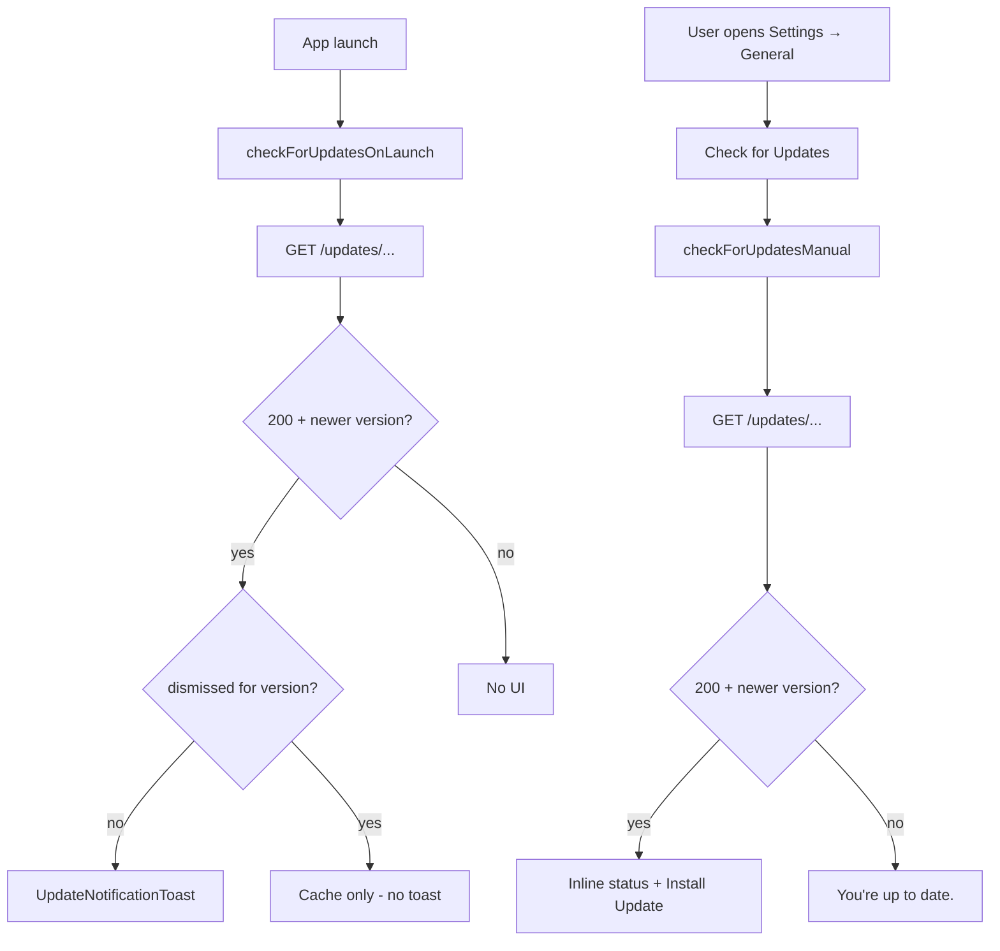
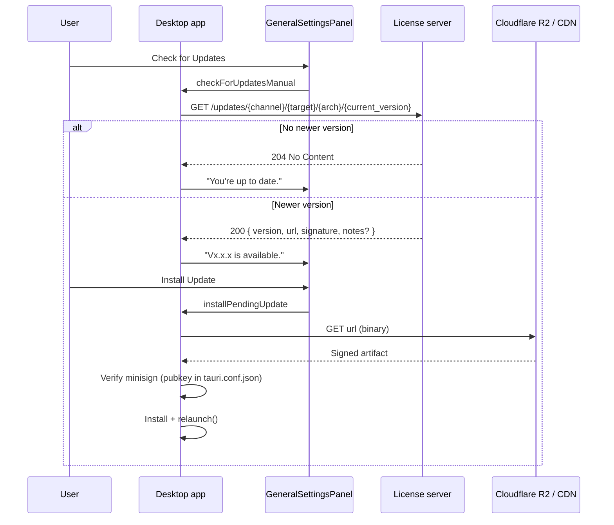

# Desktop app updates (Tauri updater)

This document describes how **Gitoza** desktop checks for new application builds, where **release binaries** are stored, and how installation and restart work.

**Scope:** Tauri desktop only. The Vite web dev build does not run the updater.

---

## 1. Overview

| Concern | Mechanism |
|---------|-----------|
| **Is a newer build available?** | Once on launch (`checkForUpdatesOnLaunch`) and on demand via **Check for Updates** → `GET` to license server → small JSON manifest (or `204`) |
| **Where is the installer?** | URL in JSON — typically **Cloudflare R2** (`gitoza-releases`), not the license server |
| **Who installs?** | User clicks **Install Update** in the corner toast or Settings → General |
| **Who may install?** | All desktop users |

The desktop app checks for updates **once on launch** and shows a small corner toast when a newer version is available. Users can also check manually in Settings → General. There is **no** background interval (e.g. no 72-hour polling). Launch check failures are silent (`console.debug` only).

Production stable downloads use **`stable/`** R2 paths. RC builds use **`rc/`** and are served only to RC desktop builds via `GET /updates/rc/...` (strict channel isolation — see §4).

---

## 2. Update check flow



| Flow | Trigger | Endpoint | Purpose |
|------|---------|----------|---------|
| **Launch update check** | App start (Tauri only; skipped when version is `0.0.0` / `0.0.0-dev`) | `GET /updates/{channel}/{target}/{arch}/{current_version}` via `checkForUpdatesOnLaunch` | Corner toast when update available and not dismissed |
| **Manual update check** | Settings → General → **Check for Updates** | Same endpoint via `checkForUpdatesManual` | On-demand check with inline status and install (no toast) |

Updates are not gated by any product edition or subscription.

---

## 3. End-to-end update workflow



### Step 1 — Manual check

When the user clicks **Check for Updates** in Settings → General, [`checkForUpdatesManual`](../../../frontend/src/services/updater.js) runs [`check()`](https://v2.tauri.app/plugin/updater/) from `@tauri-apps/plugin-updater`. Tauri substitutes URL placeholders from the running app:

| Placeholder | Example |
|-------------|---------|
| `{channel}` | Baked at build: `stable` or `rc` (not a Tauri placeholder — fixed in endpoint URL) |
| `{{target}}` | `darwin`, `windows`, `linux` |
| `{{arch}}` | `aarch64`, `x86_64` |
| `{{current_version}}` | From bundle (`tauri.conf.json` `version`) |

CI sets `plugins.updater.endpoints` to a one-element array: tag contains `-rc` → `rc`, otherwise `stable` (same rule as R2 prefix).

### Step 2 — Server decides “newer or not”

The license server compares `current_version` from the path to the latest semver on the **requested channel** for `target` + `arch`. Strict isolation: RC builds never see stable rows and vice versa.

### Step 3 — User installs

When an update is available, **Install Update** in Settings → General calls [`installPendingUpdate`](../../../frontend/src/services/updater.js):

1. `update.downloadAndInstall()` — downloads from the **`url` in the 200 JSON** (not necessarily the license host)
2. Verifies **minisign** `signature` against `plugins.updater.pubkey` in [`src-tauri/tauri.conf.json`](../../../src-tauri/tauri.conf.json)
3. `relaunch()` from `@tauri-apps/plugin-process` — quits and starts the new build

Permissions: `updater:default`, `process:allow-restart` in [`src-tauri/capabilities/desktop.json`](../../../src-tauri/capabilities/desktop.json).

---

## 4. Configuration: update check URLs

| Build | Update endpoint |
|-------|-----------------|
| **Release stable** (`tauri build` on stable tag) | `.../updates/stable/{{target}}/{{arch}}/{{current_version}}` — set by CI in [`release.yml`](../../../.github/workflows/release.yml) |
| **Release RC** (`tauri build` on `-rc` tag) | `.../updates/rc/{{target}}/{{arch}}/{{current_version}}` — set by CI |
| **Dev / source build** (`npm run tauri:dev`, local `tauri build`) | `plugins.updater.endpoints` is **empty** in git — launch check skipped for `0.0.0-dev`; Settings → Check for Updates shows “Updates are not configured for this build.” |

Committed [`tauri.conf.json`](../../../src-tauri/tauri.conf.json) keeps `endpoints: []` so clones and forks do not phone home by default. Release CI ([`set-app-version-from-tag.mjs`](../../../.github/scripts/set-app-version-from-tag.mjs)) injects the public update host and channel (`stable` vs `rc`) into the binary. That host is **not** a GitHub secret (it is a public `GET` API and appears in released apps). Use RC builds for real update testing.

---

## 5. Request and response contract (license server)

### Request

- **Method:** `GET`
- **Path:** `/updates/{channel}/{target}/{arch}/{current_version}`
- **`channel`:** `stable` or `rc` — must match how the binary was built

No authentication or license headers. Public read for update metadata.

### Response

| Condition | HTTP | Body |
|-----------|------|------|
| No newer version | `204 No Content` | — |
| Newer version available | `200 OK` | Tauri dynamic update JSON |

**200 JSON (required fields for install):**

```json
{
  "version": "1.0.0",
  "url": "https://releases.example.com/stable/v1.0.0/Gitoza_1.0.0_aarch64.app.tar.gz",
  "signature": "<minisign signature from Tauri build>",
  "notes": "Release notes text or https://... release page URL"
}
```

---

## 6. Client-side update UI

Logic in [`frontend/src/services/updater.js`](../../../frontend/src/services/updater.js), [`frontend/src/components/UpdateNotificationToast.jsx`](../../../frontend/src/components/UpdateNotificationToast.jsx), and [`frontend/src/hooks/useAboutUpdates.js`](../../../frontend/src/hooks/useAboutUpdates.js):

- Updates are available to **all** users.
- No subscription or activation data is sent on update check or install.
- **Launch:** `checkForUpdatesOnLaunch()` runs once on desktop start for release builds (CI-injected endpoints). Skipped when the app version is the local placeholder (`0.0.0` / `0.0.0-dev`). If a newer version exists and the user has not dismissed that version (`updateNotificationPrefs.js`), a non-blocking corner toast appears.
- **Manual:** **Check for Updates** in Settings → General uses `checkForUpdatesManual()` (`emitUi: false`) — inline status only, no toast. On local `0.0.0*` builds (empty endpoints in git), it returns a clear “not configured” message instead of calling the plugin.

**UI outcomes (launch toast):**

| Result | UI |
|--------|-----|
| Update available, not dismissed | Corner toast: `Vx.x.x available` — expand for release notes + **Install Update**; **Don't show again** persists per version |
| Update available, dismissed | No toast (cached in `getLastUpdateResult()` for Settings) |
| Up to date (`204`) | No toast |
| Error | Silent (no toast) |

**UI outcomes (Settings → General):**

| Result | UI |
|--------|-----|
| Not yet checked | "Check for the latest version." |
| Up to date (`204`) | "You're up to date." |
| Update available (`200`) | "Vx.x.x is available." + **Install Update** button |
| Error | Error message inline |

The last check result is cached in `getLastUpdateResult()` for the current session only.

---

## 7. Where release files live (this repository)

Binaries are **not** required on the license server. This repo publishes them via GitHub Actions to **Cloudflare R2**. CI chooses the channel from the tag name: tags containing `-rc` upload to `rc/<tag>/`; all other `v*` tags upload to `stable/<tag>/`.

| Piece | Location |
|-------|----------|
| Workflow | [`.github/workflows/release.yml`](../../../.github/workflows/release.yml) — full pipeline doc: [`docs/arch/release_build/README.md`](../release_build/README.md) |
| Trigger | Push tag `v*` (e.g. `v1.0.0`, `v1.0.0-rc.1`) |
| Bucket | `gitoza-releases` (private; public read on `stable/*` only via R2 custom domain or policy) |
| App version | CI sets from tag (`v1.0.0-rc.2` → `1.0.0-rc.2`); git holds `0.0.0-dev` for local dev |
| Matrix | Windows NSIS (`*-setup.exe` + `.exe.sig`), macOS aarch64 (`.dmg` + `.app.tar.gz`/`.sig`), Linux x86_64 (`.AppImage` + `.AppImage.sig`) |
| Updater artifacts | `bundle.createUpdaterArtifacts: true` in `tauri.conf.json` — `.sig` + bundles for the updater |

**Release channels:**

| Channel | Tag example | R2 prefix | Updater endpoint channel | License server |
|---------|-------------|-----------|--------------------------|----------------|
| Stable | `v1.0.0` | `stable/v1.0.0/` | `stable` | `GET /updates/stable/...` |
| RC | `v1.0.0-rc.1` | `rc/v1.0.0-rc.1/` | `rc` | `GET /updates/rc/...` (RC testers only; no cross-channel promotion) |

**Example R2 layouts:**

```
gitoza-releases/stable/v1.0.0/
  Gitoza_1.0.0_x64-setup.exe
  Gitoza_1.0.0_x64-setup.exe.sig
  Gitoza_1.0.0_aarch64.dmg
  Gitoza_1.0.0_aarch64.app.tar.gz
  Gitoza_1.0.0_aarch64.app.tar.gz.sig
  Gitoza_1.0.0_amd64.AppImage
  Gitoza_1.0.0_amd64.AppImage.sig

gitoza-releases/rc/v1.0.0-rc.2/
  (same artifact types; private access only)
```

**Release checklist:**

1. Push tag: `git tag v1.0.0-rc.2 && git push origin v1.0.0-rc.2` (no manual version bump in git).
2. CI sets app version **and updater channel** from the tag, builds, signs, syncs to R2, and **POSTs release metadata** to the license server webhook ([`docs/arch/release_build/WEBHOOK.md`](../release_build/WEBHOOK.md)).
3. **Stable:** Confirm `GET /updates/stable/...` offers the new version.
4. **RC:** Confirm `GET /updates/rc/...` offers rc→rc updates (e.g. rc.7 → rc.8). Stable channel must **not** return RC versions.
5. **RC → stable:** Testers install stable manually when ready (no auto-promotion).

Signing:

- **Private key:** GitHub Actions secret (from `npm run tauri signer generate`).
- **Public key:** `plugins.updater.pubkey` in `tauri.conf.json` — must match or install fails.

---

## 8. Components in this repository

| Layer | Role | Key paths |
|-------|------|-----------|
| **Frontend** | Launch check, corner toast, manual check, install + relaunch | `frontend/src/services/updater.js`, `frontend/src/components/UpdateNotificationToast.jsx`, `frontend/src/hooks/useAboutUpdates.js`, `frontend/src/utils/updateNotificationPrefs.js`, `GeneralSettingsPanel.jsx` |
| **Tauri** | Updater + process plugins | `src-tauri/src/lib.rs`, `tauri.conf.json` |
| **License server** (external) | `GET /updates/...` | Not in this repo |

---

## 9. Troubleshooting

| Symptom | Likely cause |
|---------|----------------|
| No launch toast | User dismissed that version, already up to date, check error, or not Tauri |
| Check shows error | Wrong endpoint, server down, invalid JSON, or network unavailable |
| General shows update, install fails | Bad `url`, signature mismatch, pubkey not paired with CI signing key |
| Users got wrong channel via updater | Build has wrong endpoint URL; verify CI set `plugins.updater.endpoints` for the tag channel |
| Local build says updates not configured | Expected — git has empty `endpoints`; only tagged release CI injects the update URL |

---

## 10. Related documentation

| Document | Topic |
|----------|--------|
| [`docs/arch/release_build/README.md`](../release_build/README.md) | GitHub Actions release workflow, R2 channels, secrets, checklist |
| [`docs/arch/release_build/WEBHOOK.md`](../release_build/WEBHOOK.md) | CI → license server release registration webhook |
| [`README.md`](../../../README.md) § Versioning | Bump app version before release tag |
| [Tauri updater plugin](https://v2.tauri.app/plugin/updater/) | Official dynamic update JSON format |
